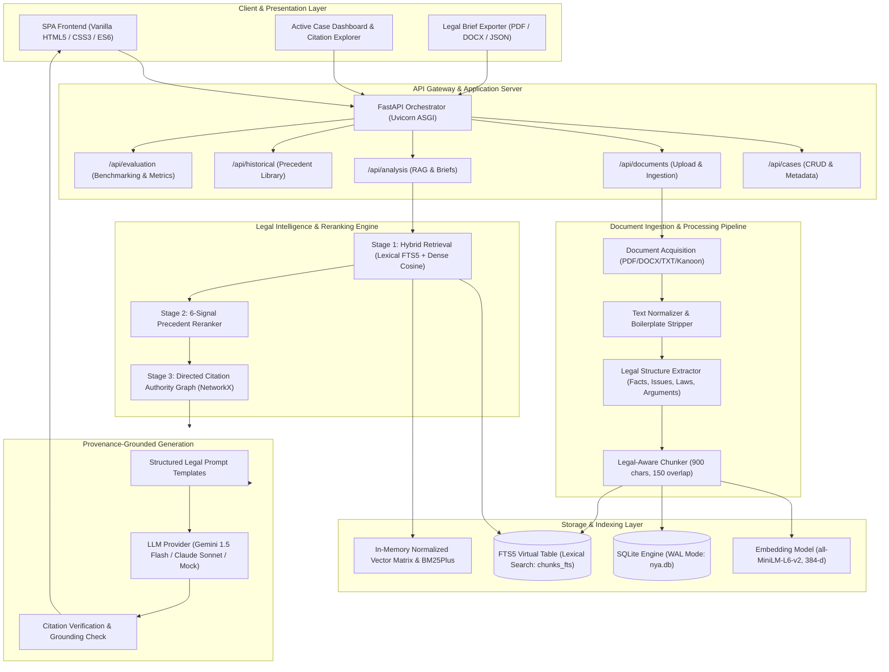
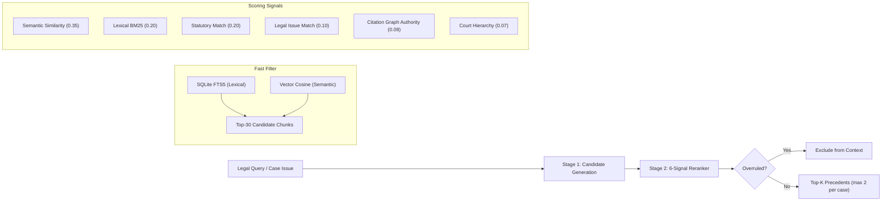
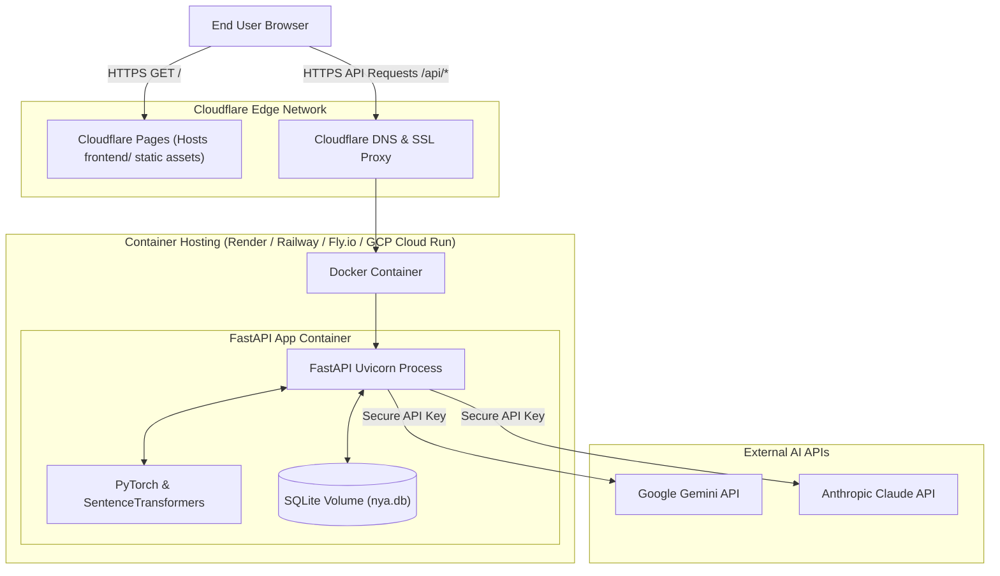

# Nya AI — Final System Architecture Specification

**Project Title:** Nya AI (न्याय AI) — AI-Assisted Legal Research, Analysis & Decision-Support Platform  
**Target Domain:** Indian Legal System & Jurisprudence (Supreme Court, High Courts, Statutory Acts)  
**Document Version:** 1.0 (Production Architecture)  

---

## 1. Executive Summary

Nya AI is a specialized legal intelligence platform built to parse, structure, search, and analyze complex legal judgments and filings under Indian law. Unlike generic document-search systems, Nya AI implements **legal-aware structure extraction**, **hybrid dense-lexical retrieval (FTS5 + Sentence-Transformers)**, a **6-signal precedent reranker** respecting the constitutional hierarchy of courts (Article 141), a **directed citation authority graph**, and a **provenance-grounded synthesis layer** where every legal assertion is backed by verifiable document citations `[S1]`, `[S2]`.

---

## 2. End-to-End System Architecture



---

## 3. Subsystem Breakdown

### Layer 1: Client & Presentation
* **Tech Stack:** Vanilla JavaScript (ES6+), Modern HTML5, Responsive Modular CSS.
* **Key Components:**
  * **Document Ingestion Workbench:** Multi-format file uploader (drag-and-drop PDF, DOCX, TXT) and Kanoon case identifier fetcher.
  * **Interactive Case Dossier:** Structured overview of extracted sections (Facts, Issues, Submissions, Evidence, Relevant Acts).
  * **Precedent & Citation Graph Viewer:** Visual inspection of authority flows and precedent citations across Supreme Court and High Court rulings.
  * **Analysis & Brief Generator:** Live view of grounded legal arguments, opposing arguments, risk points, and clickable citation chips `[S1]`, `[S2]`.

---

### Layer 2: API Gateway & Orchestration
* **Tech Stack:** FastAPI 0.115, Uvicorn ASGI Server, Pydantic v2 schemas.
* **Modular Endpoints:**
  * `cases.py`: Case lifecycle management, drafting, timeline tracking, and issue management.
  * `documents.py`: Document upload, streaming text extraction, SHA-256 caching.
  * `analysis.py`: End-to-end legal analysis triggering, RAG reasoning, and brief generation.
  * `historical.py`: Precedent exploration, filtering by court/year/statute, and Kanoon links.
  * `eval_router.py`: Empirical performance benchmarking, ablation evaluation, and metric reporting.

---

### Layer 3: Legal Ingestion & Parsing Pipeline
1. **Document Acquisition (`document_acquisition.py`):**
   * Computes SHA-256 hashes of input files to avoid duplicate processing.
   * Scrapes public legal repositories (e.g. Indian Kanoon) with retry logic and polite headers.
2. **Text Cleaning & Normalization (`text_cleaner.py`):**
   * Strips digital watermarks, page numbers, court stamps, and scraper boilerplate while strictly preserving legal paragraph identifiers, section numbers, and statutory headings.
3. **Legal Structure Extraction (`legal_structure.py` / `case_extraction.py`):**
   * Segment legal judgments into distinct structural zones:
     * *Facts & Background*
     * *Framed Legal Issues*
     * *Petitioner & Respondent Arguments*
     * *Admitted Evidence*
     * *Statutory Provisions (e.g., IPC, CrPC, CPC, Constitution, Specific Relief Act)*
     * *Judicial Reasoning & Ratio Decidendi*
     * *Final Order / Judgment Disposition*
4. **Legal-Aware Chunking (`chunking.py`):**
   * Window size: **900 characters** with **150 characters overlap**.
   * Splits honor paragraph and sentence boundaries, tagging every piece with `section_type`, character start/end offsets, and page numbers to maintain strict provenance.

---

### Layer 4: Storage, Indexing & Vector Embeddings
* **Database Engine:** Embedded **SQLite** (`backend/data/nya.db`) operated with `PRAGMA journal_mode=WAL` and `PRAGMA synchronous=NORMAL` for concurrent reader efficiency.
* **Relational Schema (`models.py`):**
  * `Case`: Main user case entity holding extracted legal fields.
  * `Document`: Uploaded legal files associated with a case.
  * `Chunk`: Atomic text segments indexed with section tags, page numbers, and vector embeddings.
  * `HistoricalCase`: Curated repository of Indian landmark precedents.
  * `Analysis`: Generated legal synthesis reports and argument matrices.
* **Lexical Index:** SQLite **FTS5 Virtual Table** (`chunks_fts`) for sub-10ms keyword and statutory phrase matching.
* **Vector Embeddings (`embeddings.py`):**
  * Primary Model: `sentence-transformers/all-MiniLM-L6-v2` (384-dimensional dense vectors).
  * Storage: Binary float32 blobs directly within SQLite and cached in-memory for high-throughput batch vector cosine similarity.

---

### Layer 5: Two-Stage Hybrid Retrieval & 6-Signal Precedent Reranker



#### The 6-Signal Weight Formulation:
$$\text{Score} = w_1 S_{\text{sem}} + w_2 S_{\text{lex}} + w_3 S_{\text{stat}} + w_4 S_{\text{issue}} + w_5 S_{\text{auth}} + w_6 S_{\text{court}}$$

* **Semantic Relevance ($0.35$):** Dense vector cosine similarity.
* **Lexical Overlap ($0.20$):** BM25Plus keyword matching across legal terminology.
* **Statute Match ($0.20$):** Direct overlap of invoked Acts, Sections, and Articles.
* **Legal Issue Alignment ($0.10$):** Semantic similarity between framed issues.
* **Citation Authority ($0.08$):** In-degree centrality within the precedent citation network.
* **Court Hierarchy ($0.07$):**
  * Supreme Court of India: **1.0** (Constitution Art. 141 binding law)
  * High Courts: **0.75** (Persuasive/State binding)
  * District Courts: **0.50**
  * Tribunals / Other: **0.40**
* **Hard Filter:** Any precedent explicitly tagged as *Overruled* is automatically purged from the candidate pool.

---

### Layer 6: Citation Authority Graph (`citation_graph.py`)
* Constructed using **NetworkX**.
* Represents precedents as directed nodes where directed edges indicate citations between judgments.
* Analyzes:
  * In-degree (how many judgments rely on this case).
  * Out-degree (depth of legal precedent backing).
  * Path distance to landmark constitutional bench judgments.

---

### Layer 7: Grounded Synthesis & LLM Integration (`llm_provider.py`)
* **Supported Backends:**
  * `gemini`: Google Gemini 1.5 Flash (via Gemini API).
  * `anthropic`: Anthropic Claude Sonnet 4.6 (via Anthropic SDK).
  * `mock`: Deterministic offline extractive analysis engine (runs zero-cost without API keys).
* **Provenance Guarantee:**
  * Prompt instructions enforce that **every factual assertion, legal doctrine, or precedent mention must cite its exact source tag (`[S1]`, `[S2]`)**.
  * Hallucination guard: The post-processing validation layer checks whether extracted citations exist in the retrieved chunk metadata before returning the response to the user.

---

## 4. Physical Directory & Module Layout

```
Major/
├── .env.example                    # Environment template (keys, provider, DB path)
├── pyproject.toml                  # Workspace build configuration
├── requirements.txt                # Python runtime dependencies
├── run.py                          # Unified one-click application launcher
├── FINAL_SYSTEM_ARCHITECTURE.md    # This architecture specification
│
├── backend/
│   ├── app/
│   │   ├── main.py                 # FastAPI application root & middleware
│   │   ├── database.py             # SQLite engine, sessionmaker, WAL pragmas
│   │   ├── models.py               # SQLAlchemy ORM models (Case, Chunk, HistoricalCase, etc.)
│   │   ├── schemas.py              # Pydantic request/response schemas
│   │   ├── routers/
│   │   │   ├── analysis.py         # RAG analysis endpoints
│   │   │   ├── cases.py            # Case management endpoints
│   │   │   ├── documents.py        # Ingestion & document endpoints
│   │   │   └── historical.py       # Precedent query endpoints
│   │   └── services/
│   │       ├── chunking.py         # 900-char legal paragraph chunker
│   │       ├── citation_graph.py   # NetworkX authority graph
│   │       ├── embeddings.py       # SentenceTransformers / local embeddings
│   │       ├── indexing.py         # Chunk persistence & FTS synchronization
│   │       ├── legal_structure.py  # Fact, issue, argument extractor
│   │       ├── llm_provider.py     # Gemini / Claude / Mock LLM dispatcher
│   │       ├── reranker.py         # 6-signal court-hierarchy reranker
│   │       └── retrieval.py        # FTS5 + Dense hybrid retrieval engine
│   ├── data/
│   │   ├── nya.db                  # Primary SQLite file database
│   │   └── historical_cases/       # Landmark Indian case baseline corpus (.txt)
│   └── scripts/
│       ├── seed_historical_cases.py# Baseline corpus indexer
│       └── ingest_dataset.py       # Bulk dataset loader
│
├── frontend/
│   ├── index.html                  # Single Page Application container
│   ├── app.js                      # UI state management, API calls, event handlers
│   └── styles.css                  # Responsive legal portal styling
│
├── config/
│   └── reranker_weights.json       # Calibrated 6-signal weights & court scoring
│
└── evaluation/
    ├── metrics.py                  # Precision@K, Recall@K, MRR, NDCG calculation
    ├── provenance_validator.py     # Verification of citation grounding
    └── run_evaluation.py           # Automated evaluation harness
```

---

## 5. Deployment Architecture



* **Frontend:** Deployed to **Cloudflare Pages** for zero-latency static asset delivery and edge caching.
* **Backend:** Packaged into a standard **Docker Container** running on a container PaaS (Render, Railway, Fly.io, or GCP Cloud Run) to accommodate PyTorch and Python runtime requirements.
* **Security & Routing:** Cloudflare handles custom domain DNS, DDoS protection, and SSL termination.
